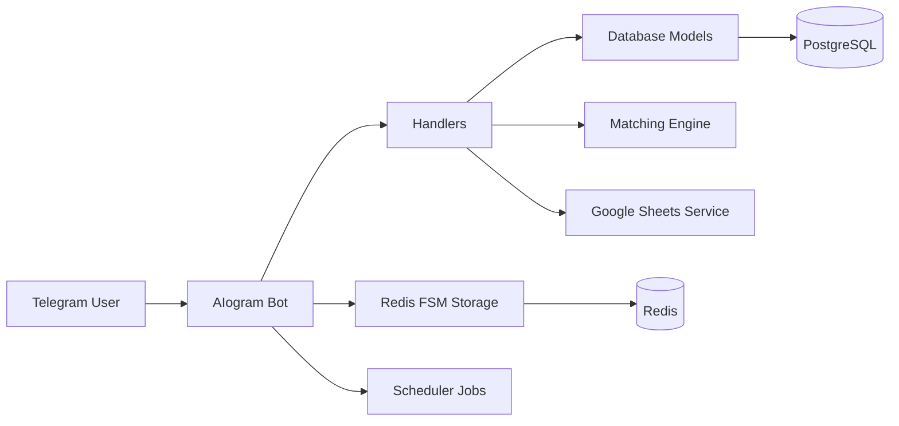

# HR Specialist

<div align="center">


[](https://www.python.org/)
[](https://docs.aiogram.dev/)
[](https://www.postgresql.org/)
[](https://redis.io/)
[](https://docs.docker.com/compose/)
[](https://www.google.com/sheets/about/)

# HR Specialist Bot

Smart recruitment automation for Telegram — built to streamline hiring, talent discovery, candidate matching, interviews, and admin management from one place.

</div>

## ✨ Overview

HR Specialist is a Telegram-based HR and recruitment bot built with Python and AIogram. It allows candidates to submit job applications, employers to publish vacancies, relevant profiles to be matched automatically, interview workflows to be organized, and admins to manage the platform with a creator dashboard.

The platform combines:

- Telegram-first user experience
- PostgreSQL-powered data persistence
- Redis-based FSM and session storage
- Google Sheets synchronization for reporting
- Scheduled background jobs with APScheduler
- Dockerized deployment for fast start-up

## 🚀 Why this project matters

Recruitment processes often break down because of fragmented communication, manual candidate filtering, and slow administrative workflows. HR Specialist centralizes the experience inside Telegram, where users already spend time, making hiring faster, more accessible, and operationally efficient.

## 🌟 Core features

- Candidate resume submission with structured onboarding
- Employer vacancy posting and management
- Automated candidate-vacancy matching engine
- Interview scheduling and tracking workflows
- Creator/admin panel for analytics and moderation
- Premium subscription and referral balance features
- Google Sheets integration for real-time data capture
- Containerized setup for local and deployment environments

## 🧩 Architecture



## 📁 Project structure

```text
hr-specialist/
├── .env
├── .gitattributes
├── docker-compose.yml
├── main.py
├── requirements.txt
├── README.md
├── config/
│   └── settings.py
├── database/
│   ├── db_helper.py
│   ├── models.py
│   └── __pycache__/
├── handlers/
│   ├── anketa.py
│   ├── creator.py
│   ├── interview.py
│   ├── payments.py
│   ├── start.py
│   └── __pycache__/
├── keyboards/
│   └── inline.py
├── middlewares/
│   └── admin.py
├── services/
│   ├── credentials.json
│   ├── google-sheets.py
│   ├── matching.py
│   └── scheduler.py
└── __pycache__/
```

## 🏗️ Tech stack

- Python 3.11+
- AIogram 3.x
- SQLAlchemy 2.x
- PostgreSQL 15
- Redis 7
- Google Sheets API
- APScheduler
- Pydantic Settings
- Docker / Docker Compose

## 🧪 Demo and preview

<div align="center">


</div>

### Demo flow

1. User starts the Telegram bot
2. Candidate completes a structured resume form
3. Employer posts a vacancy
4. Matching service suggests relevant people
5. Interview process is coordinated inside Telegram
6. Creator/admin inspects analytics and manages premium access

> Replace the placeholder image with actual screenshots from your production/demo environment to showcase the UI and flows.

## ⚙️ Installation

### 1) Clone the repository

```bash
git clone https://github.com/Timaty7/hr-specialist.git
cd hr-specialist
```

### 2) Create a virtual environment

```bash
python -m venv venv
source venv/bin/activate
# Windows:
# venv\Scripts\activate
```

### 3) Install dependencies

```bash
pip install -r requirements.txt
```

### 4) Configure environment variables

Create a `.env` file in the project root:

```env
BOT_TOKEN=your_telegram_bot_token
DATABASE_URL=postgresql+asyncpg://postgres:postgres_password@db:5432/smart_chef
REDIS_URL=redis://redis:6379/0
GOOGLE_SHEET_ID=your_google_sheet_id
CREATOR_ID=your_telegram_user_id
```

## 🐳 Run with Docker

This project includes a full Docker Compose configuration for PostgreSQL and Redis.

```bash
docker compose up --build
```

This starts:

- PostgreSQL database
- Redis cache/FSM storage
- Telegram bot service

To stop services:

```bash
docker compose down
```

## ▶️ Run locally

If your services are already running, you can start the bot directly:

```bash
python main.py
```

## 🗄️ Data model

The application uses SQLAlchemy models for the core recruitment flow:

- `User` — role, subscription state, balance, referrals
- `Resume` — candidate profile and application data
- `Vacancy` — employer job postings
- `WithdrawalRequest` — payout and status tracking

## 🤖 Bot workflow

Typical user journey:

1. Open the bot from Telegram
2. Select a role: candidate or employer
3. Complete the application or vacancy form
4. Receive candidate/vacancy matches automatically
5. Start interview coordination
6. Track platform analytics as admin

## 📊 Admin and creator commands

The admin panel supports the following commands:

- `/admin` — display the creator dashboard
- `/stats` — view total users, resumes, vacancies, and subscription counts
- `/give_sub <user_tg_id>` — grant premium access for 30 days
- `/add_balance <user_tg_id> <amount>` — top up referral balance
- `/ban <user_tg_id>` — restrict user access
- `/broadcast <message>` — send a message to all users

## 🔒 Security notes

- Keep secrets in `.env` and never commit production credentials
- Restrict admin endpoints to trusted creator IDs only
- Validate external data before writing to the database or spreadsheet
- Use secure deployment configurations for production environments

## 🤝 Contribution

Contributions are welcome. To propose a change:

```bash
git checkout -b feature/your-feature
git commit -m "Add your feature"
git push origin feature/your-feature
```

Then open a pull request and describe the improvement clearly.

## 📞 Contact

For project questions, collaboration, or production deployment support, reach out through the repository owner or maintainer on GitHub.

---

Built for modern HR operations in Telegram.
